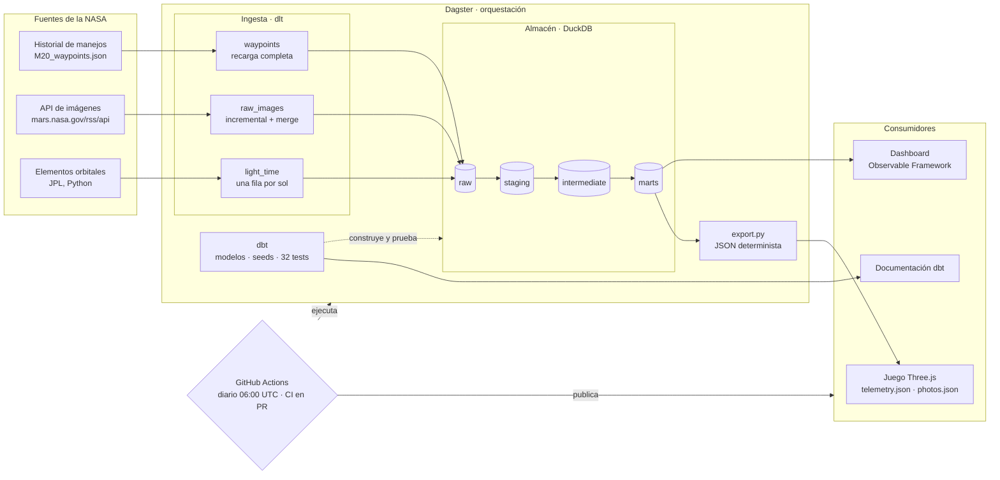
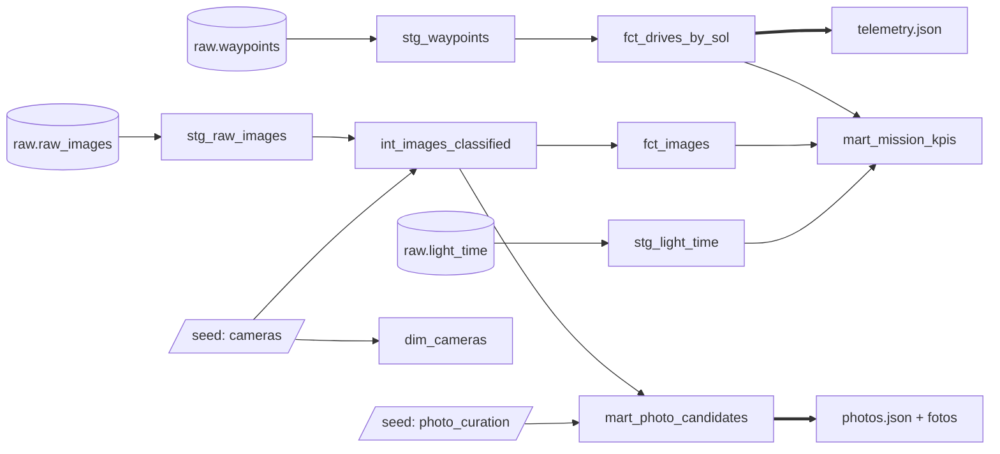
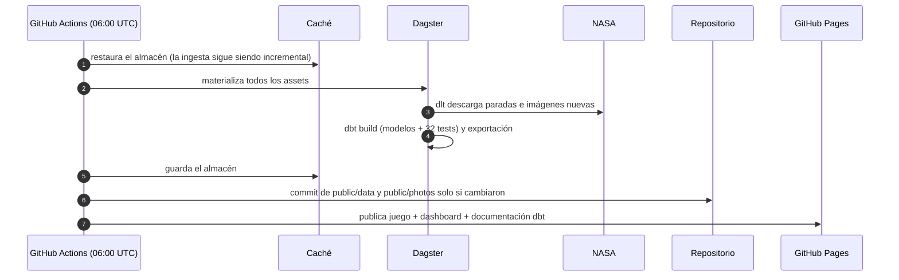

# Perseverance — Simulación del rover en Marte

[](https://github.com/javiladino/perseverance/actions/workflows/ci.yml)
[](https://github.com/javiladino/perseverance/actions/workflows/pipeline.yml)

[English](README.md) · [Français](README.fr.md) · **Español**

Una simulación 3D del rover Perseverance de la NASA en Marte, hecha con Three.js. Conduce el rover por las dunas, sigue la telemetría real de la NASA en un panel de control de misión y haz clic en las cámaras del rover para ver fotos reales tomadas en Marte en los últimos días.


## Qué tiene

- **Rover conducible** — el modelo 3D oficial de la NASA, manejado con el teclado, que deja huellas en la arena.
- **Física de Marte** — gravedad marciana (3,71 m/s²), agarre limitado en pendientes (no sube más de ~29°), resistencia a la rodadura en la arena y suspensión rocker-bogie rueda por rueda.
- **Ruedas reales** — las 6 ruedas giran a la velocidad de su punto de contacto; las 4 de las esquinas se orientan, y se colocan en diagonal para girar sobre sí mismo, como el rover real.
- **Control de misión** — inspirado en [Open MCT](https://github.com/nasa/openmct) de la NASA: cada dato tiene nombre, unidad y proveedor.
  - Distancia recorrida, altura del terreno e inclinación, del historial de manejos de la NASA.
  - Tiempo de luz entre la Tierra y Marte, calculado en vivo con las órbitas de los dos planetas.
  - Cada uno muestra su valor, una gráfica de toda la misión y una frase simple de qué significa.
- **Cámaras del rover** — Mastcam-Z, Navcam, Hazcam y WATSON brillan sobre el modelo. Haz clic: obturador, flash y una foto real que se revela ante tus ojos.
- **Ambiente** — cielo caramelo, sol bajo de tarde con sombras, polvo en suspensión, Fobos y Deimos.


## Plataforma de datos (modern data stack)

El juego es el último consumidor de un pequeño *modern data stack*, gratuito y reproducible de punta a punta. Cada día, un pipeline automático carga, modela, prueba y publica los datos públicos de la NASA. El control de misión y las cámaras del rover solo leen los archivos que ese pipeline exporta.

### Explóralo

| Qué | Enlace |
|---|---|
| 🎮 Juego jugable | https://javiladino.github.io/perseverance/ |
| 📊 Dashboard de datos (Observable Framework) | https://javiladino.github.io/perseverance/dashboard/ |
| 📚 Documentación de dbt y linaje de modelos | https://javiladino.github.io/perseverance/dbt/ |
| ⚙️ Ejecuciones del pipeline diario | https://github.com/javiladino/perseverance/actions/workflows/pipeline.yml |
| ✅ Ejecuciones del CI (pull requests) | https://github.com/javiladino/perseverance/actions/workflows/ci.yml |
| 🐍 Código de ingesta, exportación y Dagster | [`data/percy_pipeline/`](data/percy_pipeline/) |
| 🧱 Proyecto dbt | [`data/percy_dbt/`](data/percy_dbt/) |
| 📈 Código del dashboard | [`dashboard/`](dashboard/) |
| 🔁 Workflows | [`.github/workflows/`](.github/workflows/) |
| 🗺️ Interfaz de Dagster (local) | http://127.0.0.1:3000, ver [Ejecutarlo en local](#ejecutarlo-en-local) |

### Arquitectura



### Linaje de los modelos dbt



### Cómo está construida, capa por capa

| Capa | Herramienta | Qué hace | Código |
|---|---|---|---|
| Ingesta | [dlt](https://dlthub.com) | Carga el historial de manejos (recarga completa), las imágenes de las 4 cámaras del juego (cursor incremental por `date_received`, fusión por `imageid`) y el tiempo de luz Tierra–Marte por sol. dlt infiere y versiona los esquemas. | [`ingestion/nasa.py`](data/percy_pipeline/ingestion/nasa.py) |
| Órbitas | Python | Port de la fórmula de tiempo de luz del juego. pytest la compara con la versión en JavaScript (±0,01 min). | [`orbits.py`](data/percy_pipeline/orbits.py) |
| Almacén | [DuckDB](https://duckdb.org) | Un solo archivo (`warehouse/percy.duckdb`) con los esquemas `raw`, `staging`, `intermediate`, `marts` y `seeds`. | — |
| Transformación | [dbt](https://www.getdbt.com) + dbt-duckdb | **staging:** tipos, nombres, UTC. **intermediate:** reglas de color y calidad a partir de los identificadores de NASA. **marts:** hechos y dimensiones que consumen el juego y el dashboard. | [`percy_dbt/models/`](data/percy_dbt/models/) |
| Persona en el circuito | seed de dbt | Las reglas de dbt eligen las fotos candidatas; la decisión estética final (`approved` / `rejected`) vive en un CSV versionado. | [`photo_curation.csv`](data/percy_dbt/seeds/photo_curation.csv) |
| Exportación | Python | Escribe `public/data/telemetry.json` (23 KB en lugar de los 525 KB del archivo crudo) y `public/photos/photos.json`, y descarga las fotos aprobadas. La salida es determinista: si los datos no cambian, no hay commit. | [`export.py`](data/percy_pipeline/export.py) |
| Orquestación | [Dagster](https://dagster.io) + dagster-dbt | Un único grafo de assets, de NASA a los archivos del juego. Los tests de dbt aparecen como asset checks, dos checks bloqueantes protegen el contrato de datos del juego y una programación lo ejecuta cada día a las 06:00 UTC. | [`definitions.py`](data/percy_pipeline/definitions.py) |
| Dashboard | [Observable Framework](https://observablehq.com/framework/) | Un sitio estático. Sus cargadores de datos en Python leen los marts al compilar. | [`dashboard/src/`](dashboard/src/) |
| CI/CD | GitHub Actions | **CI** en cada pull request: ruff, pytest, el pipeline completo y la comprobación del juego en el navegador. **Diario:** refresca los datos, hace commit solo si cambiaron y publica el juego, el dashboard y la documentación de dbt en GitHub Pages. | [`ci.yml`](.github/workflows/ci.yml) · [`pipeline.yml`](.github/workflows/pipeline.yml) |


### Calidad de datos

En cada ejecución corren 32 tests de dbt: unicidad, no nulos, relaciones, valores aceptados, rangos, frescura de las fuentes y dos tests propios (el odómetro nunca baja; cada cámara tiene una foto aprobada). Detectaron problemas reales:

- **Odómetro a 0.** Las paradas intermedias (`final = 'm'/'i'`) del historial de NASA no traen odómetro, y hundían a cero la gráfica de distancia del juego. Los marts solo guardan las paradas confirmadas.
- **Horas desplazadas.** La hora de las fotos dependía de la zona horaria del equipo. Ahora se convierte a UTC de forma explícita.
- **Orden no determinista.** Dos fotos con la misma hora de captura se intercambiaban entre ejecuciones y provocaban commits vacíos del bot. Ahora se desempata por `image_id`.

### La ejecución diaria



### Ejecutarlo en local

Necesitas [uv](https://docs.astral.sh/uv/) y Node.js.

```bash
cd data
uv sync
uv run dbt parse --project-dir percy_dbt --profiles-dir percy_dbt
uv run dagster dev -m percy_pipeline.definitions   # interfaz en http://127.0.0.1:3000 → "Materialize all"

# o paso a paso
uv run python -m percy_pipeline.ingestion.run           # dlt → DuckDB
(cd percy_dbt && uv run dbt build --profiles-dir .)     # modelos + tests
uv run python -m percy_pipeline.export                  # marts → archivos del juego
uv run pytest && uv run ruff check .

cd ../dashboard && npm install && npm run dev           # dashboard en http://127.0.0.1:3000
```

Para aprobar fotos nuevas, añade su `image_id` con `approved` a [`photo_curation.csv`](data/percy_dbt/seeds/photo_curation.csv). La tabla "Curación de fotos" del dashboard muestra cuántas esperan revisión.

## Controles

| Tecla | Acción |
|---|---|
| `W` `A` `S` `D` (QWERTY) · `Z` `Q` `S` `D` (AZERTY) | Avanzar, retroceder y girar |
| Ratón | Girar la cámara alrededor del rover |
| `T` | Mostrar / ocultar el control de misión |
| Clic en un punto que brilla | Tomar una foto con esa cámara |
| Clic en la foto | Ampliarla |
| `←` `→` | Más fotos de la misma cámara |
| `Esc` | Volver al juego |

## Cómo empezar

Necesitas Node.js y Google Chrome (Chrome solo hace falta para `npm run check`).

```bash
npm install
npm run dev        # http://127.0.0.1:5173
```

| Script | Qué hace |
|---|---|
| `npm run dev` | Servidor de desarrollo |
| `npm run build` | Versión de producción en `dist/` |
| `npm run check` | Abre el juego en Chrome y comprueba que cargan los 4 datos, que `T` oculta el panel, que cada cámara abre una foto real y que la consola no tiene errores. Guarda una captura en `screenshots/check-camara.png` |

## Estructura del proyecto

```
src/
  main.js         escena, luces, bucle de render
  rover.js        modelo, controles y física de Marte
  wheels.js       separa las 6 ruedas del modelo
  tracks.js       huellas en la arena
  telemetry.js    mini API de telemetría (patrón de Open MCT)
  providers.js    historial de manejos de la NASA + tiempo de luz Tierra–Marte
  hud.js          panel de control de misión
  cameras.js      puntos de las cámaras y visor de fotos
  terrain.js, sky.js, rocks.js, dust.js, moons.js
public/
  models/         modelo 3D de Perseverance (Draco)
  data/           telemetry.json exportado desde los marts de dbt
  photos/         fotos sin procesar elegidas + photos.json
scripts/
  check.mjs       comprobación automática en el navegador
data/
  percy_pipeline/ ingesta con dlt, órbitas, exportación, definiciones de Dagster
  percy_dbt/      modelos, seeds y tests de dbt
  tests/          pytest
dashboard/        dashboard con Observable Framework
.github/workflows/ CI y pipeline diario
mapa-del-repo.html  guía de Open MCT
```

## Datos y créditos

- **Modelo 3D:** Perseverance, NASA/JPL-Caltech.
- **Historial de manejos:** [M20_waypoints.json](https://mars.nasa.gov/mmgis-maps/M20/Layers/json/M20_waypoints.json), NASA/JPL-Caltech. Lo carga la plataforma de datos; el juego solo lee los marts exportados.
- **Fotos:** [imágenes sin procesar de Mars 2020](https://mars.nasa.gov/mars2020/multimedia/raw-images/), con el crédito en cada foto (NASA/JPL-Caltech, NASA/JPL-Caltech/ASU). Filtradas por reglas de dbt y aprobadas a mano en el seed `photo_curation`.
- **Órbitas:** elementos orbitales aproximados de JPL (Standish), válidos entre 1800 y 2050.
- Hecho con [Three.js](https://threejs.org) y [Vite](https://vite.dev).

Proyecto personal y educativo, sin relación oficial con la NASA.
