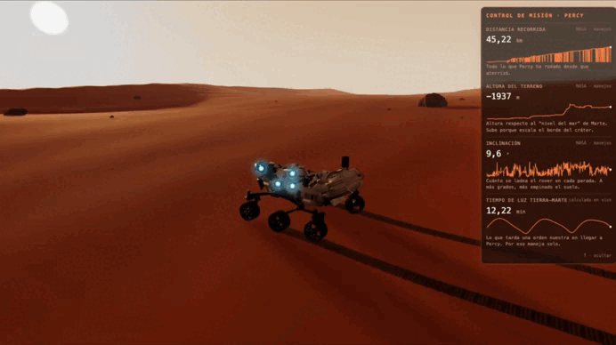
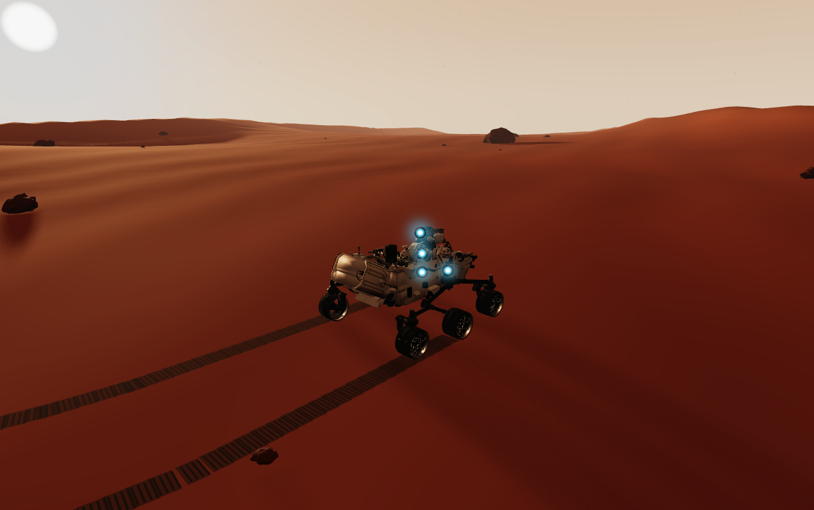
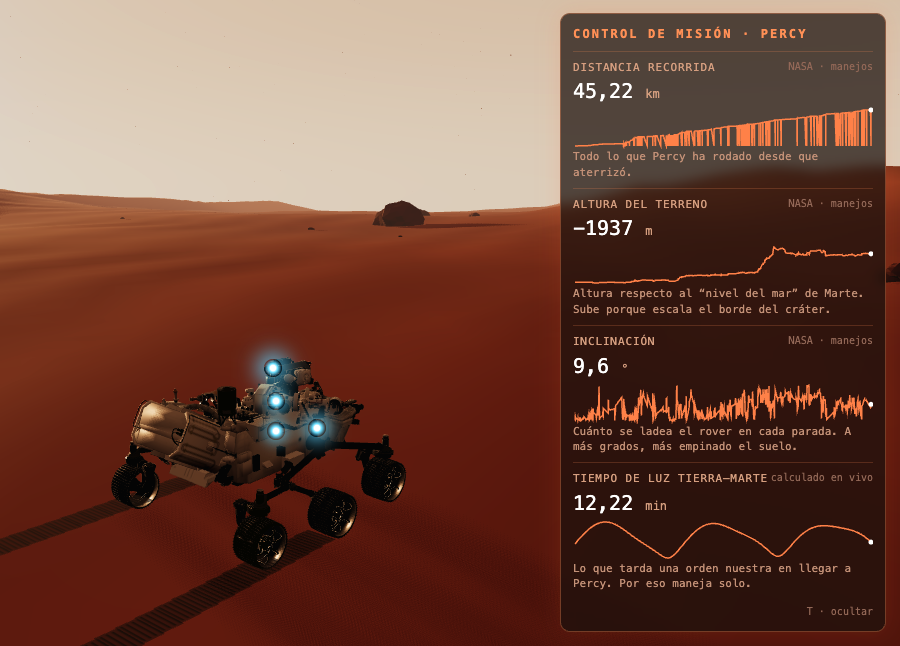
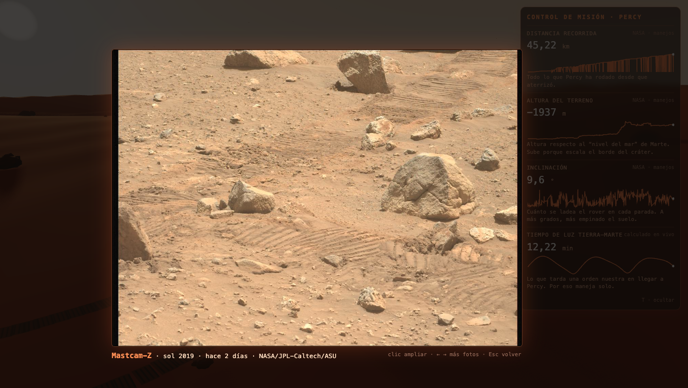

# Perseverance — Simulación del rover en Marte

[English](README.md) · [Français](README.fr.md) · **Español**

Una simulación 3D del rover Perseverance de la NASA en Marte, hecha con Three.js. Conduce el rover por las dunas, sigue la telemetría real de la NASA en un panel de control de misión y haz clic en las cámaras del rover para ver fotos reales tomadas en Marte en los últimos días.




## Qué tiene

- **Rover conducible** — el modelo 3D oficial de la NASA, manejado con el teclado, que deja huellas en la arena.
- **Física de Marte** — gravedad marciana (3,71 m/s²), agarre limitado en pendientes (no sube más de ~29°), resistencia a la rodadura en la arena y suspensión rocker-bogie rueda por rueda.
- **Ruedas reales** — las 6 ruedas giran a la velocidad de su punto de contacto; las 4 de las esquinas se orientan, y se colocan en diagonal para girar sobre sí mismo, como el rover real.
- **Control de misión** — inspirado en [Open MCT](https://github.com/nasa/openmct) de la NASA: cada dato tiene nombre, unidad y proveedor.
  - Distancia recorrida, altura del terreno e inclinación, del historial de manejos de la NASA.
  - Tiempo de luz entre la Tierra y Marte, calculado en vivo con las órbitas de los dos planetas.
  - Cada uno muestra su valor, una gráfica de toda la misión y una frase simple de qué significa.
- **Cámaras del rover** — Mastcam-Z, Navcam, Hazcam y WATSON brillan sobre el modelo. Haz clic: obturador, flash y una foto real que se revela ante tus ojos.
- **Ambiente** — cielo caramelo, sol bajo de tarde con sombras, polvo en suspensión, Fobos y Deimos.






## Controles

| Tecla | Acción |
|---|---|
| `W` `A` `S` `D` (QWERTY) · `Z` `Q` `S` `D` (AZERTY) | Avanzar, retroceder y girar |
| Ratón | Girar la cámara alrededor del rover |
| `T` | Mostrar / ocultar el control de misión |
| Clic en un punto que brilla | Tomar una foto con esa cámara |
| Clic en la foto | Ampliarla |
| `←` `→` | Más fotos de la misma cámara |
| `Esc` | Volver al juego |

## Cómo empezar

Necesitas Node.js y Google Chrome (Chrome solo hace falta para `npm run check`).

```bash
npm install
npm run dev        # http://127.0.0.1:5173
```

| Script | Qué hace |
|---|---|
| `npm run dev` | Servidor de desarrollo |
| `npm run build` | Versión de producción en `dist/` |
| `npm run check` | Abre el juego en Chrome y comprueba que cargan los 4 datos, que `T` oculta el panel, que cada cámara abre una foto real y que la consola no tiene errores. Guarda una captura en `screenshots/check-camara.png` |
| `npm run datos:nasa` | Descarga la copia más reciente del historial de manejos de la NASA en `public/data/` |

## Estructura del proyecto

```
src/
  main.js         escena, luces, bucle de render
  rover.js        modelo, controles y física de Marte
  wheels.js       separa las 6 ruedas del modelo
  tracks.js       huellas en la arena
  telemetry.js    mini API de telemetría (patrón de Open MCT)
  providers.js    historial de manejos de la NASA + tiempo de luz Tierra–Marte
  hud.js          panel de control de misión
  cameras.js      puntos de las cámaras y visor de fotos
  terrain.js, sky.js, rocks.js, dust.js, moons.js
public/
  models/         modelo 3D de Perseverance (Draco)
  data/           copia del historial de manejos de la NASA
  photos/         fotos sin procesar elegidas + photos.json
scripts/
  check.mjs       comprobación automática en el navegador
  fetch-nasa.mjs  actualiza el historial de manejos
mapa-del-repo.html  guía de Open MCT
```

## Datos y créditos

- **Modelo 3D:** Perseverance, NASA/JPL-Caltech.
- **Historial de manejos:** [M20_waypoints.json](https://mars.nasa.gov/mmgis-maps/M20/Layers/json/M20_waypoints.json), NASA/JPL-Caltech. Se guarda una copia local porque el servidor de la NASA bloquea a los navegadores sin ventana (headless).
- **Fotos:** [imágenes sin procesar de Mars 2020](https://mars.nasa.gov/mars2020/multimedia/raw-images/), con el crédito en cada foto (NASA/JPL-Caltech, NASA/JPL-Caltech/ASU). Elegidas a mano: a color, sin cielo vacío, sin sol ni objetivos de calibración.
- **Órbitas:** elementos orbitales aproximados de JPL (Standish), válidos entre 1800 y 2050.
- Hecho con [Three.js](https://threejs.org) y [Vite](https://vite.dev).

Proyecto personal y educativo, sin relación oficial con la NASA.
