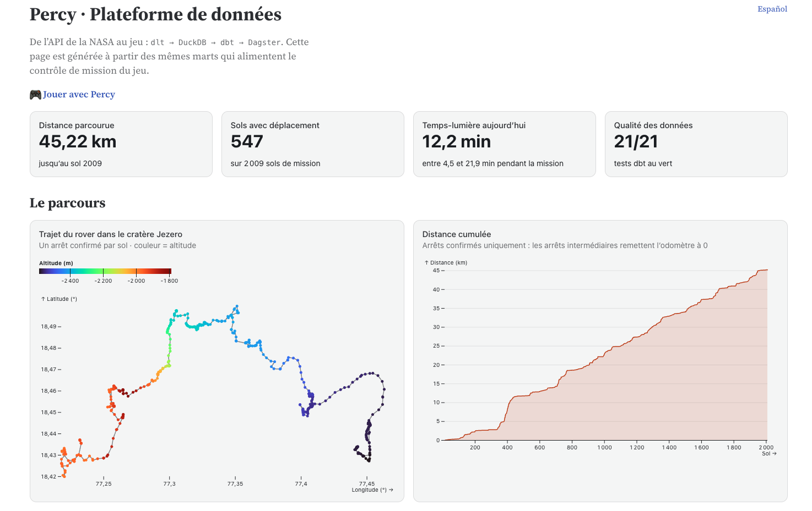
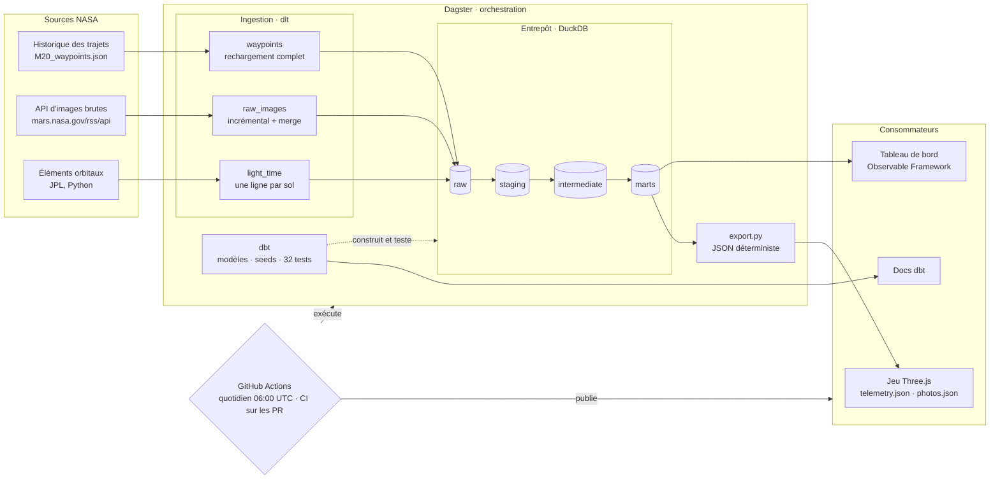
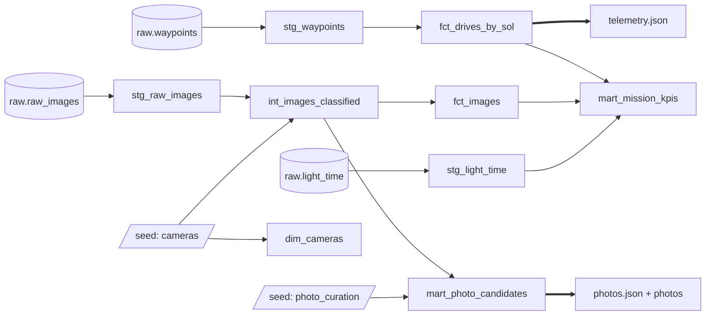
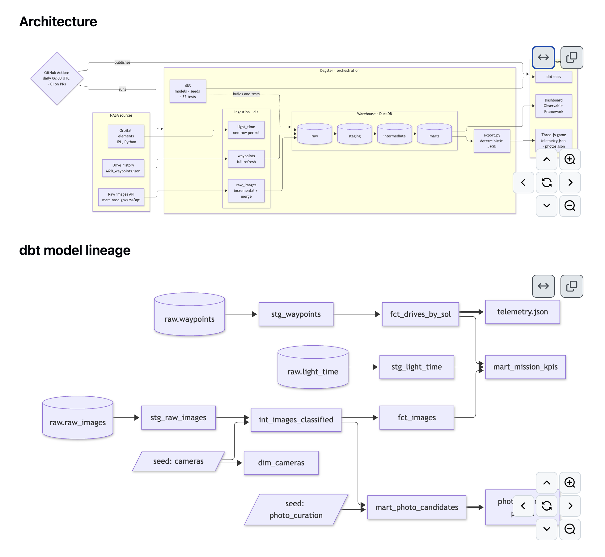
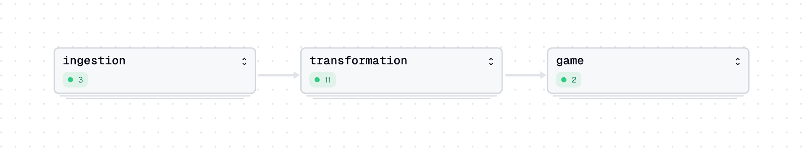
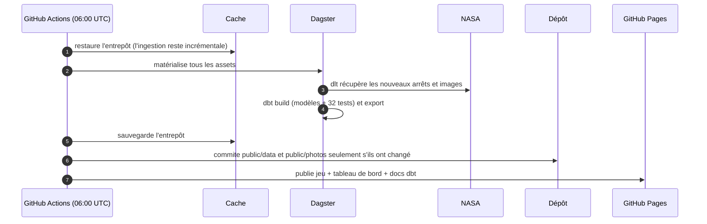

# Perseverance — Simulation du rover martien

[](https://github.com/javiladino/perseverance/actions/workflows/ci.yml)
[](https://github.com/javiladino/perseverance/actions/workflows/pipeline.yml)

[English](README.md) · **Français** · [Español](README.es.md)

Une simulation 3D du rover Perseverance de la NASA sur Mars, réalisée avec Three.js. Pilotez le rover à travers les dunes, suivez la télémétrie réelle de la NASA dans un panneau de contrôle de mission, et cliquez sur les caméras du rover pour voir de vraies photos prises sur Mars ces derniers jours.


## Fonctionnalités

- **Rover pilotable** — le modèle 3D officiel de la NASA, piloté au clavier, qui laisse des traces dans le sable.
- **Physique martienne** — gravité de Mars (3,71 m/s²), adhérence limitée en pente (il ne monte pas au-delà de ~29°), résistance au roulement dans le sable et suspension rocker-bogie roue par roue.
- **Vraies roues** — les 6 roues tournent à la vitesse de leur point de contact ; les 4 roues d'angle s'orientent, et se placent en diagonale pour tourner sur place, comme le vrai rover.
- **Contrôle de mission** — inspiré d'[Open MCT](https://github.com/nasa/openmct) de la NASA : chaque donnée a un nom, une unité et un fournisseur.
  - Distance parcourue, altitude du terrain et inclinaison, issues de l'historique des trajets de la NASA.
  - Temps-lumière Terre–Mars, calculé en direct à partir des orbites des deux planètes.
  - Chacune affiche sa valeur, un graphique de toute la mission et une explication simple.
- **Caméras du rover** — Mastcam-Z, Navcam, Hazcam et WATSON brillent sur le modèle. Cliquez : obturateur, flash, et une vraie photo se révèle sous vos yeux.
- **Ambiance** — ciel caramel, soleil bas d'après-midi avec ombres, poussière en suspension, Phobos et Deimos.


## Plateforme de données (modern data stack)

Le jeu est le dernier consommateur d'une petite *modern data stack*, gratuite et entièrement reproductible. Chaque jour, un pipeline automatique charge, modélise, teste et publie les données publiques de la NASA. Le contrôle de mission et les caméras du rover ne lisent que les fichiers exportés par ce pipeline.

### Explorer

| Quoi | Lien |
|---|---|
| 🎮 Jeu jouable | https://javiladino.github.io/perseverance/ |
| 📊 Tableau de bord des données (Observable Framework) | https://javiladino.github.io/perseverance/dashboard/ |
| 📚 Documentation dbt et lignage des modèles | https://javiladino.github.io/perseverance/dbt/ |
| ⚙️ Exécutions du pipeline quotidien | https://github.com/javiladino/perseverance/actions/workflows/pipeline.yml |
| ✅ Exécutions de la CI (pull requests) | https://github.com/javiladino/perseverance/actions/workflows/ci.yml |
| 🐍 Code d'ingestion, d'export et Dagster | [`data/percy_pipeline/`](data/percy_pipeline/) |
| 🧱 Projet dbt | [`data/percy_dbt/`](data/percy_dbt/) |
| 📈 Code du tableau de bord | [`dashboard/`](dashboard/) |
| 🔁 Workflows | [`.github/workflows/`](.github/workflows/) |
| 🗺️ Interface Dagster (locale) | http://127.0.0.1:3000, voir [Exécution locale](#exécution-locale) |



### Architecture



### Lignage des modèles dbt



<details>
<summary>Image statique des diagrammes</summary>



</details>

### Comment elle est construite, couche par couche

| Couche | Outil | Rôle | Code |
|---|---|---|---|
| Ingestion | [dlt](https://dlthub.com) | Charge l'historique des trajets (rechargement complet), les images brutes des 4 caméras du jeu (curseur incrémental sur `date_received`, fusion sur `imageid`) et le temps-lumière Terre–Mars par sol. dlt infère et versionne les schémas. | [`ingestion/nasa.py`](data/percy_pipeline/ingestion/nasa.py) |
| Orbites | Python | Portage de la formule de temps-lumière du jeu. pytest la compare à la version JavaScript (±0,01 min). | [`orbits.py`](data/percy_pipeline/orbits.py) |
| Entrepôt | [DuckDB](https://duckdb.org) | Un seul fichier (`warehouse/percy.duckdb`) avec les schémas `raw`, `staging`, `intermediate`, `marts` et `seeds`. | — |
| Transformation | [dbt](https://www.getdbt.com) + dbt-duckdb | **staging :** types, noms, UTC. **intermediate :** règles de couleur et de qualité tirées des identifiants NASA. **marts :** faits et dimensions consommés par le jeu et le tableau de bord. | [`percy_dbt/models/`](data/percy_dbt/models/) |
| Humain dans la boucle | seed dbt | Les règles dbt sélectionnent les photos candidates ; la décision esthétique finale (`approved` / `rejected`) se trouve dans un CSV versionné. | [`photo_curation.csv`](data/percy_dbt/seeds/photo_curation.csv) |
| Export | Python | Écrit `public/data/telemetry.json` (23 Ko au lieu des 525 Ko du fichier brut) et `public/photos/photos.json`, et télécharge les photos approuvées. La sortie est déterministe : sans nouvelles données, pas de commit. | [`export.py`](data/percy_pipeline/export.py) |
| Orchestration | [Dagster](https://dagster.io) + dagster-dbt | Un seul graphe d'assets, de la NASA aux fichiers du jeu. Les tests dbt apparaissent comme asset checks, deux checks bloquants protègent le contrat de données du jeu, et une planification l'exécute chaque jour à 06:00 UTC. | [`definitions.py`](data/percy_pipeline/definitions.py) |
| Tableau de bord | [Observable Framework](https://observablehq.com/framework/) | Un site statique. Ses chargeurs de données Python lisent les marts à la compilation. | [`dashboard/src/`](dashboard/src/) |
| CI/CD | GitHub Actions | **CI** sur chaque pull request : ruff, pytest, le pipeline complet et la vérification du jeu dans le navigateur. **Quotidien :** rafraîchit les données, ne commite que si elles ont changé, puis publie le jeu, le tableau de bord et les docs dbt sur GitHub Pages. | [`ci.yml`](.github/workflows/ci.yml) · [`pipeline.yml`](.github/workflows/pipeline.yml) |



### Qualité des données

32 tests dbt tournent à chaque exécution : unicité, non-nullité, relations, valeurs acceptées, plages de valeurs, fraîcheur des sources et deux tests sur mesure (l'odomètre ne diminue jamais ; chaque caméra a une photo approuvée). Ils ont détecté de vrais problèmes :

- **Odomètre remis à 0.** Les arrêts intermédiaires (`final = 'm'/'i'`) de l'historique NASA n'ont pas d'odomètre, ce qui faisait plonger à zéro le graphique de distance du jeu. Les marts ne gardent que les arrêts confirmés.
- **Horodatages décalés.** L'heure des photos dépendait du fuseau horaire de la machine. Elle est désormais convertie explicitement en UTC.
- **Ordre non déterministe.** Deux photos prises à la même heure échangeaient leur place d'une exécution à l'autre et déclenchaient des commits vides du bot. Les égalités sont maintenant départagées par `image_id`.

### L'exécution quotidienne



### Exécution locale

Nécessite [uv](https://docs.astral.sh/uv/) et Node.js.

```bash
cd data
uv sync
uv run dbt parse --project-dir percy_dbt --profiles-dir percy_dbt
uv run dagster dev -m percy_pipeline.definitions   # interface sur http://127.0.0.1:3000 → « Materialize all »

# ou étape par étape
uv run python -m percy_pipeline.ingestion.run           # dlt → DuckDB
(cd percy_dbt && uv run dbt build --profiles-dir .)     # modèles + tests
uv run python -m percy_pipeline.export                  # marts → fichiers du jeu
uv run pytest && uv run ruff check .

cd ../dashboard && npm install && npm run dev           # tableau de bord sur http://127.0.0.1:3000
```

Pour approuver de nouvelles photos, ajoutez leur `image_id` avec `approved` dans [`photo_curation.csv`](data/percy_dbt/seeds/photo_curation.csv). Le tableau « Curación de fotos » du tableau de bord indique combien attendent une revue.

## Commandes

| Touche | Action |
|---|---|
| `W` `A` `S` `D` (QWERTY) · `Z` `Q` `S` `D` (AZERTY) | Avancer, reculer et tourner |
| Souris | Tourner la caméra autour du rover |
| `T` | Afficher / masquer le contrôle de mission |
| `FR` · `ES` | Langue de l'interface : français par défaut, espagnol au choix (ou `?lang=es` dans l'URL) |
| Clic sur un point lumineux | Prendre une photo avec cette caméra |
| Clic sur la photo | L'agrandir |
| `←` `→` | Autres photos de la même caméra |
| `Échap` | Revenir au jeu |

## Démarrage

Nécessite Node.js et Google Chrome (Chrome sert uniquement à `npm run check`).

```bash
npm install
npm run dev        # http://127.0.0.1:5173
```

| Script | Rôle |
|---|---|
| `npm run dev` | Serveur de développement |
| `npm run build` | Build de production dans `dist/` |
| `npm run check` | Ouvre le jeu dans Chrome et vérifie que les 4 données se chargent, que `T` masque le panneau, que chaque caméra ouvre une vraie photo et que la console est sans erreur. Enregistre une capture dans `screenshots/check-camara.png` |

## Structure du projet

```
src/
  main.js         scène, lumières, boucle de rendu
  rover.js        modèle, commandes et physique martienne
  wheels.js       sépare les 6 roues du modèle
  tracks.js       traces dans le sable
  telemetry.js    mini API de télémétrie (modèle Open MCT)
  providers.js    historique des trajets NASA + temps-lumière Terre–Mars
  hud.js          panneau de contrôle de mission
  cameras.js      points des caméras et visionneuse de photos
  terrain.js, sky.js, rocks.js, dust.js, moons.js
public/
  models/         modèle 3D de Perseverance (Draco)
  data/           telemetry.json exporté depuis les marts dbt
  photos/         images brutes sélectionnées + photos.json
scripts/
  check.mjs       vérification automatique dans le navigateur
data/
  percy_pipeline/ ingestion dlt, orbites, export, définitions Dagster
  percy_dbt/      modèles, seeds et tests dbt
  tests/          pytest
dashboard/        tableau de bord Observable Framework
.github/workflows/ CI et pipeline quotidien
mapa-del-repo.html  guide d'Open MCT (en espagnol)
```

## Données et crédits

- **Modèle 3D :** Perseverance, NASA/JPL-Caltech.
- **Historique des trajets :** [M20_waypoints.json](https://mars.nasa.gov/mmgis-maps/M20/Layers/json/M20_waypoints.json), NASA/JPL-Caltech. Chargé par la plateforme de données ; le jeu ne lit que les marts exportés.
- **Photos :** [images brutes de Mars 2020](https://mars.nasa.gov/mars2020/multimedia/raw-images/), crédit indiqué sur chaque photo (NASA/JPL-Caltech, NASA/JPL-Caltech/ASU). Filtrées par des règles dbt et approuvées à la main dans le seed `photo_curation`.
- **Orbites :** éléments orbitaux approchés du JPL (Standish), valables de 1800 à 2050.
- Réalisé avec [Three.js](https://threejs.org) et [Vite](https://vite.dev).

Projet personnel et éducatif, sans lien avec la NASA.
