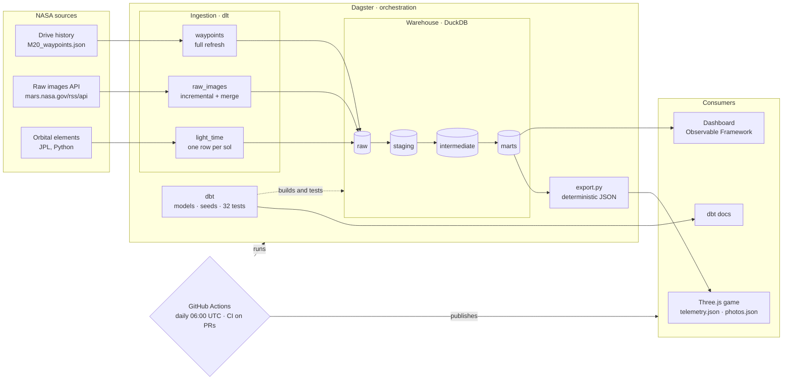
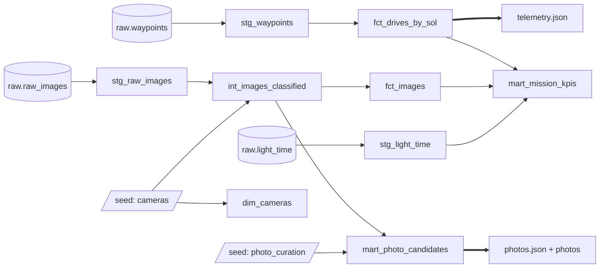
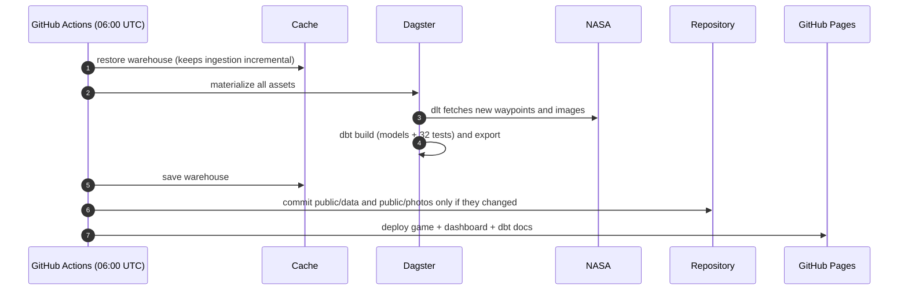

# Perseverance — Mars Rover Simulation

[](https://github.com/javiladino/perseverance/actions/workflows/ci.yml)
[](https://github.com/javiladino/perseverance/actions/workflows/pipeline.yml)

**English** · [Français](README.fr.md) · [Español](README.es.md)

A 3D simulation of NASA's Perseverance rover on Mars, built with Three.js. Drive the rover across the dunes, watch NASA's real telemetry in a mission control panel, and click the rover's cameras to see real photos taken on Mars in the last few days.


## Features

- **Drivable rover** — NASA's official 3D model, driven with the keyboard, leaving tracks in the sand.
- **Martian physics** — Mars gravity (3.71 m/s²), limited traction on slopes (it can't climb beyond ~29°), rolling resistance in the sand, and per-wheel rocker-bogie suspension.
- **Real wheels** — all 6 wheels spin at the speed of their contact point; the 4 corner wheels steer, and they angle diagonally for turns in place, just like the real rover.
- **Mission control** — inspired by NASA's [Open MCT](https://github.com/nasa/openmct): each data point has a name, a unit and a provider.
  - Distance driven, terrain elevation and tilt, from NASA's drive history.
  - Earth–Mars light time, computed live from the orbits of both planets.
  - Each one shows its value, a chart of the whole mission and a plain-language explanation.
- **Rover cameras** — Mastcam-Z, Navcam, Hazcam and WATSON glow on the model. Click one: shutter, flash, and a real photo develops in front of you.
- **Atmosphere** — butterscotch sky, low afternoon sun with shadows, suspended dust, Phobos and Deimos.


## Data platform (modern data stack)

The game is the last consumer of a small, free and fully reproducible modern data stack. Every day, NASA's public data is ingested, modelled, tested and published by an automated pipeline. The mission control panel and the rover cameras only read the files that pipeline exports.

### Explore it

| What | Link |
|---|---|
| 🎮 Playable game | https://javiladino.github.io/perseverance/ |
| 📊 Data dashboard (Observable Framework) | https://javiladino.github.io/perseverance/dashboard/ |
| 📚 dbt documentation and model lineage | https://javiladino.github.io/perseverance/dbt/ |
| ⚙️ Daily pipeline runs | https://github.com/javiladino/perseverance/actions/workflows/pipeline.yml |
| ✅ CI runs (pull requests) | https://github.com/javiladino/perseverance/actions/workflows/ci.yml |
| 🐍 Ingestion, export and Dagster code | [`data/percy_pipeline/`](data/percy_pipeline/) |
| 🧱 dbt project | [`data/percy_dbt/`](data/percy_dbt/) |
| 📈 Dashboard code | [`dashboard/`](dashboard/) |
| 🔁 Workflows | [`.github/workflows/`](.github/workflows/) |
| 🗺️ Dagster UI (local) | http://127.0.0.1:3000, see [Run it locally](#run-it-locally) |

### Architecture



### dbt model lineage



### How it is built, layer by layer

| Layer | Tool | What it does | Code |
|---|---|---|---|
| Ingestion | [dlt](https://dlthub.com) | Loads the drive history (full refresh), the raw images of the 4 game cameras (incremental cursor on `date_received`, merged on `imageid`) and the Earth–Mars light time per sol. Schemas are inferred and versioned by dlt. | [`ingestion/nasa.py`](data/percy_pipeline/ingestion/nasa.py) |
| Orbits | Python | Port of the game's light-time formula. pytest checks it against the JavaScript version (±0.01 min). | [`orbits.py`](data/percy_pipeline/orbits.py) |
| Warehouse | [DuckDB](https://duckdb.org) | A single file (`warehouse/percy.duckdb`) with the schemas `raw`, `staging`, `intermediate`, `marts` and `seeds`. | — |
| Transformation | [dbt](https://www.getdbt.com) + dbt-duckdb | **staging:** types, names, UTC. **intermediate:** colour and quality rules from NASA's image IDs. **marts:** facts and dimensions consumed by the game and the dashboard. | [`percy_dbt/models/`](data/percy_dbt/models/) |
| Human in the loop | dbt seed | dbt rules pick candidate photos; the final aesthetic decision (`approved` / `rejected`) lives in a versioned CSV. | [`photo_curation.csv`](data/percy_dbt/seeds/photo_curation.csv) |
| Export | Python | Writes `public/data/telemetry.json` (23 KB instead of the 525 KB raw file) and `public/photos/photos.json`, and downloads approved photos. The output is deterministic, so unchanged data produces no commit. | [`export.py`](data/percy_pipeline/export.py) |
| Orchestration | [Dagster](https://dagster.io) + dagster-dbt | One asset graph from NASA to the game files. dbt tests appear as asset checks, two blocking checks guard the game's data contract, and a schedule runs daily at 06:00 UTC. | [`definitions.py`](data/percy_pipeline/definitions.py) |
| Dashboard | [Observable Framework](https://observablehq.com/framework/) | A static site. Its Python data loaders read the marts at build time. | [`dashboard/src/`](dashboard/src/) |
| CI/CD | GitHub Actions | **CI** on every pull request: ruff, pytest, the full pipeline and the in-browser game check. **Daily:** refresh the data, commit only if it changed, and publish the game, dashboard and dbt docs to GitHub Pages. | [`ci.yml`](.github/workflows/ci.yml) · [`pipeline.yml`](.github/workflows/pipeline.yml) |


### Data quality

32 dbt tests run on every execution: uniqueness, not-null, relationships, accepted values, value ranges, source freshness, and two custom tests (the odometer never decreases; every camera has an approved photo). They caught real issues:

- **Odometer reset to 0.** Intermediate stops (`final = 'm'/'i'`) in NASA's drive history have no odometer value, which made the game's distance chart dip to zero. The marts only keep confirmed stops.
- **Shifted timestamps.** Photo times depended on the machine's time zone. They are now converted to UTC explicitly.
- **Non-deterministic order.** Two photos with the same capture time swapped places between runs and triggered empty bot commits. Ties are now broken by `image_id`.

### The daily run



### Run it locally

Requires [uv](https://docs.astral.sh/uv/) and Node.js.

```bash
cd data
uv sync
uv run dbt parse --project-dir percy_dbt --profiles-dir percy_dbt
uv run dagster dev -m percy_pipeline.definitions   # UI at http://127.0.0.1:3000 → "Materialize all"

# or step by step
uv run python -m percy_pipeline.ingestion.run           # dlt → DuckDB
(cd percy_dbt && uv run dbt build --profiles-dir .)     # models + tests
uv run python -m percy_pipeline.export                  # marts → game files
uv run pytest && uv run ruff check .

cd ../dashboard && npm install && npm run dev           # dashboard at http://127.0.0.1:3000
```

To approve new photos, add their `image_id` with `approved` to [`photo_curation.csv`](data/percy_dbt/seeds/photo_curation.csv). The "Photo curation" table on the dashboard shows how many are waiting for review.

## Controls

| Key | Action |
|---|---|
| `W` `A` `S` `D` (QWERTY) · `Z` `Q` `S` `D` (AZERTY) | Drive and steer |
| Mouse | Orbit the camera around the rover |
| `T` | Show / hide mission control |
| Click a glowing dot | Take a photo with that camera |
| Click the photo | Enlarge it |
| `←` `→` | More photos from the same camera |
| `Esc` | Back to the game |

## Getting started

Requires Node.js and Google Chrome (Chrome is only needed for `npm run check`).

```bash
npm install
npm run dev        # http://127.0.0.1:5173
```

| Script | What it does |
|---|---|
| `npm run dev` | Development server |
| `npm run build` | Production build in `dist/` |
| `npm run check` | Opens the game in Chrome and verifies the 4 data points load, that `T` hides the panel, that every camera opens a real photo, and that the console is error-free. Saves a screenshot to `screenshots/check-camara.png` |

## Project structure

```
src/
  main.js         scene, lights, render loop
  rover.js        model, controls and Martian physics
  wheels.js       splits the 6 wheels out of the model
  tracks.js       tracks in the sand
  telemetry.js    mini telemetry API (Open MCT pattern)
  providers.js    NASA drive history + Earth–Mars light time
  hud.js          mission control panel
  cameras.js      camera spots and photo viewer
  terrain.js, sky.js, rocks.js, dust.js, moons.js
public/
  models/         Perseverance 3D model (Draco)
  data/           telemetry.json exported from the dbt marts
  photos/         selected raw images + photos.json
scripts/
  check.mjs       automated in-browser check
data/
  percy_pipeline/ dlt ingestion, orbits, export, Dagster definitions
  percy_dbt/      dbt models, seeds and tests
  tests/          pytest
dashboard/        Observable Framework dashboard
.github/workflows/ CI and daily pipeline
mapa-del-repo.html  guide to Open MCT (in Spanish)
```

## Data and credits

- **3D model:** Perseverance, NASA/JPL-Caltech.
- **Drive history:** [M20_waypoints.json](https://mars.nasa.gov/mmgis-maps/M20/Layers/json/M20_waypoints.json), NASA/JPL-Caltech. Ingested by the data platform; the game only reads the exported marts.
- **Photos:** [Mars 2020 raw images](https://mars.nasa.gov/mars2020/multimedia/raw-images/), credited in each photo (NASA/JPL-Caltech, NASA/JPL-Caltech/ASU). Filtered by dbt rules and approved by hand in the `photo_curation` seed.
- **Orbits:** approximate orbital elements from JPL (Standish), valid 1800–2050.
- Built with [Three.js](https://threejs.org) and [Vite](https://vite.dev).

This is a personal, educational project and is not affiliated with NASA.
